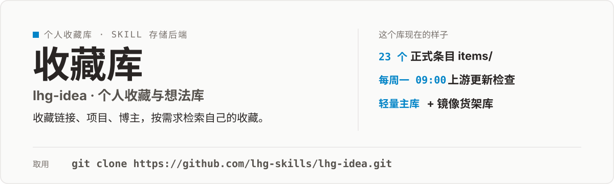

<p align="center">
  
</p>

# lhg-idea · 个人收藏与想法库

`lhg-idea` skill 的存储后端。收录我收藏的项目、工具、想关注的人、以及自己的想法，并为将来的某个需求保留检索入口。

- **主库（本仓库）**：条目 + 清单 + 自动化配置，永远轻量，只有文字条目和配置。
- **[lhg-idea-archive](https://github.com/lhg-skills/lhg-idea-archive)**：收藏的 GitHub 项目整包镜像（分支 `mirror/<owner>/<repo>/*`），仅个人使用，勿公开重分发。
- **自动化**：`.github/workflows/track.yml` 每周一 09:00（UTC+8）检查上游更新与关注对象的新仓库，汇总到本仓库标签为 `updates` 的 issue。

现在库里有 23 个正式条目（`items/`），`inbox/` 目前是空的——未消化的原始收藏都在这里先落脚，消化完才进正式条目。

## 三个命令

`SKILL.md` 是这个 skill 的完整指令。用法只有三条：

```
收藏 <链接|名字> [理由]    → 研究 → 确认理由 → 收藏或丢弃
找 <需求>                 → 按需求检索自己收藏过的东西
更新                      → 汇报本周上游动态
```

仓库本身就是知识库，所有操作最终落为 git 提交并推送。

## 它怎么工作

1. **收藏**：给一个链接或名字，skill 先研究这个项目、工具或博主，再确认收藏理由，理由立不住就丢弃。
2. **检索**：不靠文件夹分类，靠条目里的**触发场景**段 + frontmatter `topics` 匹配你的需求。
3. **更新**：每周一自动检查上游更新与关注对象的新仓库，汇总到 `updates` 标签的 issue 里。

## 受控主题词表（topics）

新增词需在此登记。初始词表（17 个）：

`视频制作` `动效库` `agent技能` `skill工程` `prompt工程` `TTS字幕` `剪映` `Remotion` `前端` `数据可视化` `金融数据` `宏观资讯` `写作` `效率工具` `AI基础设施` `产品设计` `运营增长`

## 目录结构

```
SKILL.md            skill 的完整指令（交互流程、命令、模板）
items/              正式条目，一物一文件，平铺（23 个）
inbox/              未消化的原始收藏（status: seed，目前为空）
data/tracked.json   自动化跟踪清单（仓库 SHA、关注对象的仓库基线）
scripts/track.py    定时检查脚本，由 workflow 调用
```

## 维护

- 每周 workflow 需要一个 secret `ARCHIVE_PAT`（可访问 lhg-idea-archive 的 fine-grained PAT）用于刷新镜像；未配置时检查照常、镜像跳过并在 issue 中提示。
- 手动触发检查：Actions → track-upstream → Run workflow，或 `gh workflow run track.yml -R lhg-skills/lhg-idea`。

本仓库目前没有单独的 LICENSE 文件；收藏的 GitHub 项目完整镜像仅个人使用，勿公开重分发。

---

## 出品：刘洪光

本库由真人出镜 IP「刘洪光」（安徽合肥）出品，归属 [lhg-skills](https://github.com/lhg-skills)。

- GitHub 主页：https://github.com/lhg-skills —— 全部 skill 开源在此，欢迎 star
- 抖音：搜「刘老师讲AI实战」
- 微信：lhgsmsw

觉得有用，欢迎点 ⭐ Star。
